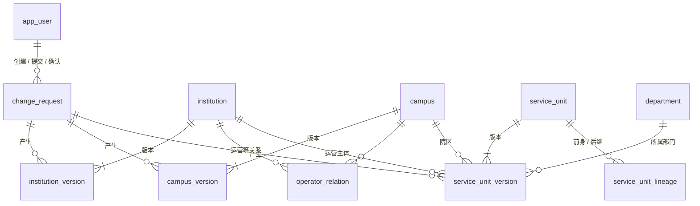
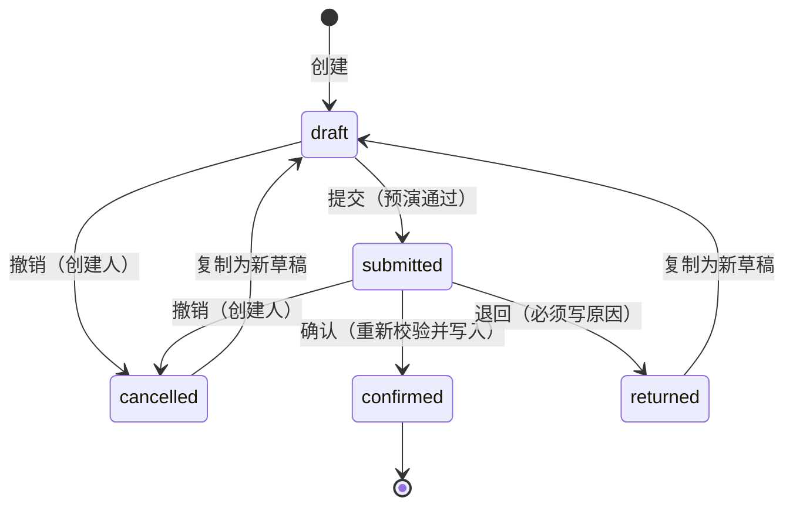
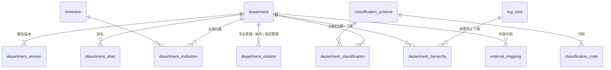

# HDIP 数据库设计

2026-10-15 · PostgreSQL 18 · 迁移目录 `migrations/versions/` · 当前迁移版本见 [schema-reference.md](schema-reference.md)

本文是数据库的**设计说明**：结构为什么是这样、规则在哪一层保证、数据怎样写入和读取，以及已经规划但尚未实施的部分。

逐列、逐约束的**结构参考**由脚本从数据库生成，见 [schema-reference.md](schema-reference.md)。迁移后执行 `make db-doc` 更新，不要手改。

| 文档 | 内容 |
| --- | --- |
| 本文 | 设计说明、约定、写入与读取流程、迁移史、规划中的结构 |
| [schema-reference.md](schema-reference.md) | 自动生成：每张表的列、约束、索引、触发器、触发器函数、应用账号权限、配置种子 |
| [../HDIP 轻量 MVP 设计：主体、院区、服务单元维护.md](../HDIP%20轻量%20MVP%20设计：主体、院区、服务单元维护.md) | 业务设计依据（对象、规则、验收剧本） |
| [../部门主数据深化-实施计划.md](../部门主数据深化-实施计划.md) | 部门深化的需求、决定与阶段 |

---

## 1. 全景

| 分组 | 表 | 说明 |
| --- | --- | --- |
| 配置 | `app_user`、`option_item`、`approval_rule` | 用户与角色、选项码值、确认规则。只由迁移维护，不经变更申请 |
| 申请 | `change_request` | 唯一写入入口 |
| 主体与院区 | `institution` / `institution_version`、`campus` / `campus_version`、`operator_relation` | 身份 + 版本；关系自带期间 |
| 部门 | `department` / `department_version`、`department_alias`、`department_classification`、`department_institution` | 身份 + 属性版本；别名、分类赋值、主体归属自带期间（D1，迁移 0006） |
| 字典 | `classification_scheme`、`classification_code`、`org_view` | 配置：分类方案与代码（维护人可直接维护）、组织视图 |
| 服务单元 | `service_unit` / `service_unit_version`、`service_unit_lineage` | 部门 × 院区 × 运营主体 × 期间；拆分合并的演变关系 |

## 2. 设计约定

### 2.1 三种表形态

| 形态 | 例子 | 规则 |
| --- | --- | --- |
| **身份表** | `institution`、`campus`、`service_unit` | `id`（IDENTITY）与 `code` 永久；建后整行不可更新。`code` 全局唯一，对象退出后也不释放。代码格式 `^[A-Za-z0-9][A-Za-z0-9._-]{0,63}$` |
| **版本表** | `*_version` | 一个对象的一个有效期间一行：`version_no`、`valid_from`、`valid_to`、`change_id`、`recorded_at`、`recorded_by` 加业务内容。同一对象版本期间不重叠（排他约束） |
| **关系表** | `operator_relation`、`service_unit_lineage` | 每行自带期间；端点不可改；调整 = 关闭旧行 + 新建行 |

### 2.2 时间

- **业务期间**只用 `date`，闭区间、起止都含当日，`valid_to` 为空表示长期有效。
  - 数据库里以 `daterange(valid_from, valid_to, '[]')` 表达。
  - 不重叠用 `EXCLUDE USING gist (对象 WITH =, daterange(...) WITH &&)`，依赖迁移 0001 启用的 `btree_gist`。
  - 修订在 D 生效：旧版 `valid_to = D-1`，新版 `valid_from = D`。允许未来生效日。
- **审计时间**用 `timestamp without time zone`，**不用 `timestamptz`**。写入时取 `LOCALTIMESTAMP`；连接时会话时区固定为 `HDIP_TIMEZONE`（默认 Asia/Shanghai，见 `api/src/hdip_api/core/db.py`）。
- 审计时间和业务时间分开：`recorded_at` 是系统记录时间，`valid_from` 是业务生效日。

### 2.3 不覆盖历史：三道保证

1. **权限**：应用账号 `hdip_app` 只有 SELECT / INSERT / UPDATE，没有 DELETE。权限由迁移 0002 的 `ALTER DEFAULT PRIVILEGES` 授予，所以**新表必须由 `hdip_owner` 在迁移里创建**。
2. **触发器 `hdip_guard_update(列...)`**（最新定义在迁移 0004）：
   - 只有参数里列出的列可以改。
   - 若列出了 `valid_to`，这些列只能在“`valid_to` 从空变为某日”的那一次 UPDATE 里修改，之后整行不可再改。
   - 未列任何列 = 整行不可更新（身份表、演变关系）。
   - 运营关系另外放开 `closed_change_id`、`closed_at`、`closed_by`，它们必须与结束日同一次写入。
   - 部门的赋值、归属、别名放开 `closed_change_id`，同样只能随结束日写入一次。
   - **配置字典例外**：`classification_scheme`、`classification_code` 放开名称、说明、排序、启用和维护记录列，供维护人直接维护；代码值与单选属性不可改。（迁移 0006 起，`department` 身份行整行不可更新，原先的过渡例外已收回。）
3. **变更申请终态**：`hdip_guard_change_request` 禁止修改已确认、已退回、已撤销的申请。

### 2.4 数据库强制与应用校验

- 唯一、排他、外键、检查约束都在数据库层。
- 应用层（`services/apply.py`）先做能给出清楚中文提示的校验。数据库拒绝时，用 `CONSTRAINT_MESSAGES` 把约束名译成中文。两者不一致以数据库为准。
- **新约束必须显式命名，并在 `CONSTRAINT_MESSAGES` 里补翻译。**

## 3. 写入：变更申请

- `change_request.items`（JSONB 数组）存变更项。变更项按 `kind` 区分，见 `api/src/hdip_api/schemas/items.py`。
- 对象之间用 `code` 引用，所以同一张申请里后一项可以引用前一项新建的对象。
- 确认后，`results` 存每项的前后内容。
- **同一段代码三次使用**（`services/apply.py`）：
  - 提交时：在 SAVEPOINT 里预演，然后回滚。
  - 查看时：同样在 SAVEPOINT 里预演，生成确认页的前后差异。
  - 确认时：在同一事务里真正写入。任何一项失败，整张申请回滚。
- **跨对象校验在全部变更项应用后进行**（`_check_units`）。服务单元的每个新版本，以及被停用院区、被关闭运营关系影响到的单元版本，都要满足：
  - 院区在整个期间存在且非停用。
  - 运营主体与院区有覆盖整个期间的“运营”关系，可以由多段首尾相接。
  - 所属部门在单元整个期间内须为“正式履职”（D1 起按部门版本期间校验）。被改为非正式履职的部门、被停用的院区、被关闭的运营关系，其影响到的单元版本也在此重新校验。

  所以“停用院区 + 改挂单元”可以放在同一张申请里，不论先后。
- 确认权限：`approval_rule`（对象类型 × 动作 → 确认角色、是否允许提交人自确认）。改规则不改代码。

| 对象 | 变更项 kind | 写入的表 |
| --- | --- | --- |
| 主体 | `institution.create`、`institution.revise` | `institution`、`institution_version` |
| 院区 | `campus.create`、`campus.revise`、`campus.change_status` | `campus`、`campus_version` |
| 运营关系 | `operator_relation.create`、`operator_relation.close` | `operator_relation` |
| 部门 | `department.create`、`.revise`、`.change_lifecycle`、`.classify`、`.affiliate`、`.alias_add`、`.alias_close`（旧的 `.rename`、`.change_status` 只保留读取，不能再应用） | `department`、`department_version`、`department_classification`、`department_institution`、`department_alias` |
| 服务单元 | `service_unit.create`、`.revise`、`.rebind`、`.change_department`、`.change_status`、`.retire` | `service_unit`、`service_unit_version` |
| 拆分、合并 | `service_unit.split`、`service_unit.merge` | `service_unit_version`（前身结束、后继新建）、`service_unit_lineage` |

## 4. 读取：按日期

- 所有查询都带“查看日期”，默认今天。某对象在该日的状态 = 期间覆盖该日的那一版。
- 列表默认也列出“尚未生效的计划对象”，并标 `not_yet_effective`。服务单元列表用 `include_future=false` 只看当天已生效的，这就是“某日在运营的单元”，含暂停。
- 名称显示：主体、院区、部门都取当日版本的名称（部门自 D1 起有版本）。
- 部门数口径：查看日期当天已设立且组织生命周期为“正式履职”的部门。
- 只读导出：`GET /api/export/{dataset}.csv?as_of=`，共六类数据，逻辑在 `services/export.py`。列名和列顺序是对外契约，新增列只能加在末尾。

## 5. 迁移史

| 迁移 | 内容 |
| --- | --- |
| 0001 | 启用 `btree_gist` |
| 0002 | 用户、选项、确认规则、变更申请、主体与院区、运营关系、历史保护触发器、应用账号默认权限、种子数据 |
| 0003 | 收紧历史保护：关闭信息只能随结束日写入一次 |
| 0004 | 部门、服务单元及其版本；`hdip_guard_update` 改为通过 jsonb 读取 `valid_to`，以兼容没有这一列的表 |
| 0005 | 服务单元演变关系；单元类型中文名；拆分 / 合并的确认规则 |
| 0006 | 部门深化 D1：部门属性版本（回填现有部门为第 1 版）、别名、分类方案与代码（配置）、分类赋值、主体归属、组织视图；`department` 只留身份 |

### 新增一类对象或变更的检查单

1. 写迁移（由 `hdip_owner` 执行）：显式命名约束，加排他约束和 `hdip_guard_update` 触发器；`approval_rule` 加种子。
2. `models.py` 加映射；`schemas/items.py` 加变更项；`services/apply.py` 加处理函数，登记到 `HANDLERS`，并补 `CONSTRAINT_MESSAGES`。
3. 加查询、路由（写明 `operation_id`），然后执行 `make gen`。
4. 写测试：剧本测试 `test_scriptN.py`；每条新约束在 `test_rules*.py` 里要有反例。
5. `make migrate && make db-doc`，同步本文与 CLAUDE.md。

## 6. 部门深化（D1 已实施，D2、D3 规划中）

需求与决定见 [部门主数据深化-实施计划](../部门主数据深化-实施计划.md)。

部门回答“谁在医院组织体系内承担这组职责”。它的身份不因院区、地点、负责人、人员、服务形态或核算口径变化而改变。下面是目标结构，按阶段实施。表名、列名在实施时以迁移为准。

### 6.1 D1 部门核心（已实施，迁移 0006）

**`department`（身份，改造）**
- 保留 `id`、`code`（院内管理编码）、`created_change_id`、`created_at`。
- 名称、状态迁到版本表。触发器改为整行不可更新，收回 2.3 节的例外。

**`department_version`（新增，属性版本）**

| 列 | 类型 | 说明 |
| --- | --- | --- |
| 公共版本列 | — | `department_id`、`version_no`、`valid_from`、`valid_to`、`change_id`、`recorded_at`、`recorded_by` |
| `name` | text 非空 | 正式名称。名称不是身份；更名 = 新版本，旧名称即“曾用名” |
| `short_name` | text | 简称 |
| `description` | text | 职责说明 |
| `establishment_form` | text 非空 | `STANDING` 常设部门 / `TEMPORARY` 经批准的临时部门 |
| `temporary_until` | date | 临时部门的期限；`TEMPORARY` 时必填（检查约束） |
| `lifecycle` | text 非空 | `PREPARING` 筹备 / `ACTIVE` 正式履职 / `SUSPENDED` 暂停履职 / `REVOKED` 撤销 / `SUPERSEDED` 被替代（拆并预留） |
| `admin_grade` | text | 行政级别（正式组织规格），选填；只有正式文件明确时才填，不按名称推断 |
| `duties` | text[] 非空，默认空 | 承担职责，本阶段为自由标签（如临床诊疗、教学、科研、专业质量管理） |
| `basis_note` | text | 依据文本（文号或说明），选填，不做依据对象，不校验（维持设计文档决策 3） |

约束：
- 版本期间不重叠。
- 生命周期只能沿 筹备 → 正式履职 ⇄ 暂停履职 → 撤销 / 被替代 变化，撤销、被替代是终态。这一条由应用层按最新版本校验。

**`department_alias`（新增）**
- 列：`department_id`、`kind`（`ALIAS` 别名 / `SEARCH_CODE` 检索码，沿用旧仓库码表）、`value`、期间、`change_id`。
- 同一部门、同一类别、同一值的期间不重叠。
- 曾用名由版本推出，不另存。

**`classification_scheme`、`classification_code`（新增，配置）**
- 这两张是**配置表**，不经变更申请：
  - 有维护人角色即可直接维护，不需确认，不记启用日、不设确认方。
  - 每行记 `updated_by`、`updated_at`。
  - 代码不删除，只停用（`is_active`）；代码值本身不可改（触发器）。
- 方案：`code`、`name`、`version`、`purpose`、`is_exclusive`（是否单选）。
- 代码：`scheme_id`、`code`、`name`、`criterion`（按什么判断）、`caution`（需要防止的误判）、`sort_order`、`is_active`。
- 首期只有一个方案“部门管理主分类 v1”，单选，六个代码：`CLINICAL` 临床诊疗类、`MEDTECH` 医疗技术类、`SUPPORT` 医疗辅助与专业支持类、`ADMIN` 行政与业务管理类、`OPERATIONS` 运行保障类、`RESEARCH_EDU` 科研教学业务类。
- 成本分类将来另设方案，与管理主分类允许有依据地不同。

**`department_classification`（新增，分类赋值）**
- 列：`department_id`、`scheme_id`、`code`、`is_exclusive`、期间、`change_id`、`recorded_*`。
- 单选方案在同一时点只有一个赋值：
  - `(scheme_id, is_exclusive)` 外键引用方案上的同名唯一键，保证这一列与方案一致。
  - 再用 `EXCLUDE (department_id WITH =, scheme_id WITH =, daterange WITH &&) WHERE (is_exclusive)` 约束。
- 赋值是业务数据，经变更申请（`department.classify`）提交、确认。赋值带生效日，默认当天。
- 调整 = 结束旧赋值 + 新建赋值，历史保留。
- 统计按主分类计数时，每个部门只计一次。

**`department_institution`（新增，主体归属）**
- 列：`department_id`、`institution_id`、`is_primary`、期间、`change_id`。
- 同一部门同一时点只有一个主归属（部分排他约束）。

**`org_view`（新增，配置，D1 建表、D2 使用）**
- 列：`code`、`name`、`purpose`、`single_parent`、`status`（`ACTIVE` / `PLANNED`）。
- 种子：
  - `ADMIN` 行政视图，`ACTIVE`。
  - `OPERATIONS` 运营视图、`MEDICAL_RECORD` 病案视图，`PLANNED`，先占位。

**规则变化**
- 服务单元每个版本：所属部门在单元整个期间内须为“正式履职”，按部门版本的期间校验，类比院区。
- 部门转为暂停履职、撤销或被替代时，若仍有依赖它的单元，阻止确认并列出受影响单元（并入 `_check_units`）。
- 部门数只计查看日期当天“正式履职”的部门；筹备中的部门不进入正式统计。

**现有数据迁移**
- 每个现有部门回填第 1 版：名称取当前名称；生命周期由 在用 → 正式履职、停用 → 暂停履职；设立形式取常设。
- 主分类、职责、行政级别留空，由维护人在页面里补齐。

### 6.2 D2 管理关系

**`department_hierarchy`（新增，视图内上下级）**
- 列：`view_id`、`parent_department_id`、`child_department_id`、期间、`change_id`。
- 同一视图、同一时点每个部门最多一个直接上级：`EXCLUDE (view_id, child_department_id, daterange)`。
- 不能以自己为上级（检查约束）。
- 禁止成环：在申请全部应用后统一检查，与 `_check_units` 同一位置。
- **一级 / 二级部门**指行政视图中的**组织层级**，不是专业分类层级，也不是 HIS 菜单分组：
  - 没有上级的是一级部门。
  - 上级是一级部门的是二级部门。例如信息中心之下的图书室、计算机中心。
  - 层级由关系在查看日期计算，不作为部门属性保存。
- 子部门本身也是部门，有自己的身份、版本与分类。服务单元可以挂在二级部门下。

**`department_relation`（新增，管理关系）**
- 列：`kind`（`PROFESSIONAL_MGMT` 专业管理 / `COLLABORATION` 协作 / `CAMPUS_MGMT` 院区管理）、`from_department_id`、`to_department_id`、`campus_id`（院区管理时）、`scope`（管理事项或协作范围）、期间、`change_id`。
- 专业管理按事项记录，不构成行政上级。例如医务部对临床医疗工作、护理部对护理专业的管理。
- 软件不从名称推断这些关系，由院内制度确认后录入。

### 6.3 D3 外部映射

**`external_mapping`（新增）**
- 列：`target_type`（首期只有 `department`）、`target_id`、`source_system`、`namespace`（含院区账套）、`external_code`、`external_name`、`mapping_relation`、`purpose`、期间、`change_id`。
- `mapping_relation` 沿用旧仓库码表：`EXACT` 等价 / `BROADER` 目标更宽 / `NARROWER` 目标更窄 / `RELATED` 相关 / `UNRESOLVED` 待裁决。
- 行政隶属、主分类调整都不改动映射。“待裁决”的映射不进入导出。

### 6.4 权限（预先设计）

- 本期沿用 `app_user.roles` 的三角色（维护人 / 确认人 / 只读）。
- 代码里改为按**权限键**判断，例如 `change.create`、`change.confirm`、`dictionary.maintain`。由一处映射“角色 → 权限键”：
  - 维护人拥有 `dictionary.maintain`。
  - 只读用户没有任何写权限键。
- 以后细化权限时，把这处映射换成表（如 `role_permission`），或者按对象范围授权，调用处不变。
- 变更申请的确认权限仍由 `approval_rule` 按“对象类型 × 动作”配置。

### 6.5 暂不建

- **负责人**：来自将来“岗位与任职”的有效任职关系，不在部门上存姓名。
- **部门—服务单元的其他责任关系**：本期只有服务单元版本上的“所属部门”。
- **成本分类、核算单元**：等核算域。
- **部门拆分合并**：生命周期已预留“被替代”；将来增加与 `service_unit_lineage` 同形的 `department_lineage`。
