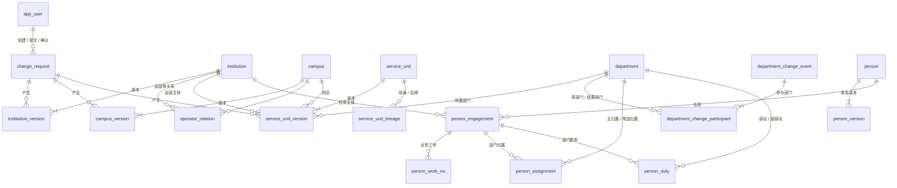
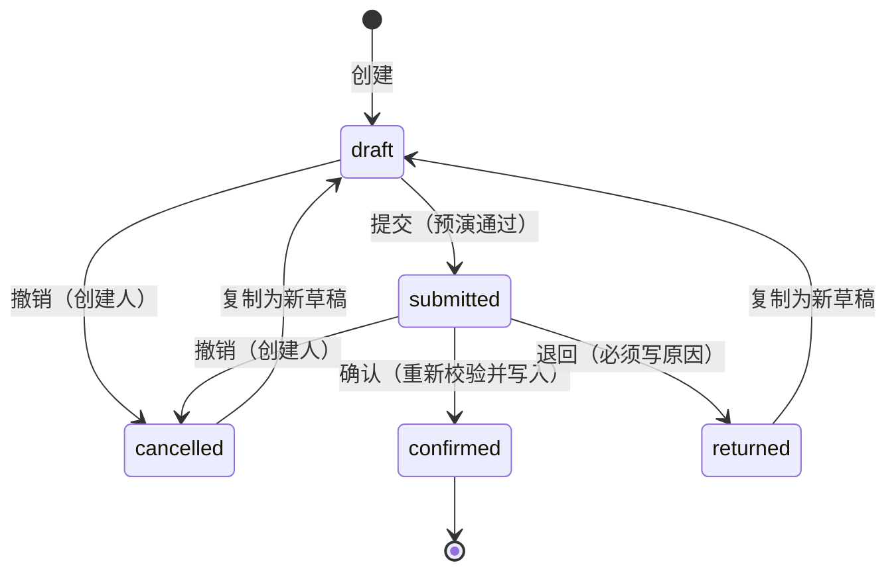
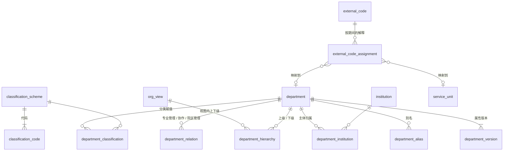

# HDIP 数据库设计

2026-10-18 · PostgreSQL 18 · 迁移目录 `migrations/versions/` · 当前迁移版本见 [schema-reference.md](schema-reference.md)

本文是数据库的**设计说明**：结构为什么是这样、规则在哪一层保证、数据怎样写入和读取，以及已经规划但尚未实施的部分。

逐列、逐约束的**结构参考**由脚本从数据库生成，见 [schema-reference.md](schema-reference.md)。迁移后执行 `make db-doc` 更新，不要手改。

| 文档 | 内容 |
| --- | --- |
| 本文 | 设计说明、约定、写入与读取流程、迁移史、规划中的结构 |
| [schema-reference.md](schema-reference.md) | 自动生成：每张表的列、约束、索引、触发器、触发器函数、应用账号权限、配置种子 |
| [../HDIP 轻量 MVP 设计：主体、院区、服务单元维护.md](../HDIP%20轻量%20MVP%20设计：主体、院区、服务单元维护.md) | 业务设计依据（对象、规则、验收剧本） |
| [../部门主数据深化-实施计划.md](../部门主数据深化-实施计划.md) | 部门深化的需求、决定与阶段 |
| [../部门组织变更-评估与分期.md](../部门组织变更-评估与分期.md) | 部门拆分、合并等组织变更：模型评估、第一期（已实施）与第二期规划 |
| [../剧本走查记录.md](../剧本走查记录.md) | 浏览器走查结果、发现的问题与处理（含 Peter 的反馈与决定） |

> **同步规则**：任何迁移、表结构或业务规则的改动，在同一次提交里同步——本文（全景表、写入表、读取与导出、迁移史及相应章节）、`make db-doc` 生成的结构参考、CLAUDE.md 的规则速查，以及相关业务文档。

---

## 1. 全景

| 分组 | 表 | 说明 |
| --- | --- | --- |
| 配置 | `app_user`、`option_item`、`approval_rule` | 用户与角色、选项码值、确认规则。只由迁移维护，不经变更申请 |
| 申请 | `change_request` | 唯一写入入口 |
| 代码分配 | `code_reservation`；序列 `campus_code_seq`、`department_code_seq`、`service_unit_code_seq`、`person_code_seq` | 系统发出的院区 / 部门 / 服务单元 / 人员代码，只追加、不可修改（迁移 0015、0016，见第 3.1 节） |
| 主体与院区 | `institution` / `institution_version`、`campus` / `campus_version`、`operator_relation` | 身份 + 版本；关系自带期间 |
| 部门 | `department` / `department_version`、`department_alias`、`department_classification`、`department_institution` | 身份 + 属性版本；别名、分类赋值、主体归属自带期间（D1，迁移 0006） |
| 字典 | `classification_scheme`、`classification_code`、`org_view` | 配置：分类方案与代码（维护人可直接维护）、组织视图 |
| 部门关系 | `department_hierarchy`、`department_relation` | 行政隶属（一级 / 二级部门）；专业管理、协作、院区管理（D2，迁移 0007） |
| 外部标识 | `source_system`、`code_namespace`、`external_code`、`external_code_assignment` | 来源系统与字典（配置）；源记录与按期间的解释（编码映射台账，D3，迁移 0008） |
| 服务单元 | `service_unit` / `service_unit_version`、`service_unit_lineage`、`service_unit_classification` | 部门 × 院区 × 运营主体 × 期间；拆分合并的演变关系；单元分类（D3） |
| 部门组织变更 | `department_change_event`、`department_change_participant` | 整体拆分 / 分设 / 吸收合并 / 合并新设的事件与参与部门的身份结论；只追加（迁移 0012，见第 7 节） |
| 人员 | `person` / `person_version`、`person_engagement`、`person_work_no`、`person_assignment`、`person_duty` | 人员身份 + 姓名版本；任用、业务工号、部门归属自带期间，结束日在到达前可改（迁移 0016，见第 8 节） |

院区版本自迁移 0010 起有“对外名称” `public_name`（对外叫法与名称不同时填写）；“节点角色” `node_role` 已停用，只保留历史取值。

院区、部门、服务单元的版本自迁移 0015 起有“拼音码” `pinyin`：名称的拼音首字母（大写字母与数字，1–64 位），随名称进版本，只用于检索，不要求唯一。表单按名称生成、可修改；变更项未给出时后端按名称生成（`services/codes.py` 的 `pinyin_of`，pypinyin）；“区”固定取 Q（前后端一致）；改名未给拼音码时按新名称重新生成。

## 2. 设计约定

### 2.1 三种表形态

| 形态 | 例子 | 规则 |
| --- | --- | --- |
| **身份表** | `institution`、`campus`、`service_unit` | `id`（IDENTITY）与 `code` 永久；建后整行不可更新。`code` 全局唯一，对象退出后也不释放。代码格式 `^[A-Za-z0-9][A-Za-z0-9._-]{0,63}$` |
| **版本表** | `*_version` | 一个对象的一个有效期间一行：`version_no`、`valid_from`、`valid_to`、`change_id`、`recorded_at`、`recorded_by` 加业务内容。同一对象版本期间不重叠（排他约束） |
| **关系表** | `operator_relation`、`service_unit_lineage` | 每行自带期间；端点不可改；调整 = 关闭旧行 + 新建行 |

### 2.2 时间

- **业务期间**只用 `date`，闭区间、起止都含当日，`valid_to` 为空表示长期有效。
  - 数据库里以 `daterange(valid_from, valid_to, '[]')` 表达。
  - 不重叠用 `EXCLUDE USING gist (对象 WITH =, daterange(...) WITH &&)`，依赖迁移 0001 启用的 `btree_gist`。
  - 修订在 D 生效：旧版 `valid_to = D-1`，新版 `valid_from = D`。允许未来生效日。
  - **未生效版本的更正**（迁移 0011）：最新版本尚未生效（开始日晚于今天）时，可在其开始日当天修订。原版本 `valid_to = valid_from - 1`，成为**空期间**——从未生效、记录保留（`apply.is_void`）；新版本自同一天起。为此四张版本表（主体、院区、部门、服务单元）的期间检查放宽为 `valid_to >= valid_from - 1`，排他约束改用等价的半开区间 `daterange(valid_from, valid_to + 1)`（空期间不与任何期间重叠）。读取“某日有效版本 / 最早计划版本”时跳过空期间版本；时间线显示为“生效前已更正”。
- **审计时间**用 `timestamp without time zone`，**不用 `timestamptz`**。写入时取 `LOCALTIMESTAMP`；连接时会话时区固定为 `HDIP_TIMEZONE`（默认 Asia/Shanghai，见 `api/src/hdip_api/core/db.py`）。
- 审计时间和业务时间分开：`recorded_at` 是系统记录时间，`valid_from` 是业务生效日。

### 2.3 不覆盖历史：三道保证

1. **权限**：应用账号 `hdip_app` 只有 SELECT / INSERT / UPDATE，没有 DELETE。权限由迁移 0002 的 `ALTER DEFAULT PRIVILEGES` 授予，所以**新表必须由 `hdip_owner` 在迁移里创建**。
2. **触发器 `hdip_guard_update(列...)`**（最新定义在迁移 0004）：
   - 只有参数里列出的列可以改。
   - 若列出了 `valid_to`，这些列只能在“`valid_to` 从空变为某日”的那一次 UPDATE 里修改，之后整行不可再改。
   - 未列任何列 = 整行不可更新（身份表、演变关系）。
   - 运营关系另外放开 `closed_change_id`、`closed_at`、`closed_by`，它们必须与结束日同一次写入。
   - 部门的赋值、归属、别名放开 `closed_change_id`，同样只能随结束日写入一次。
   - **配置字典例外**：`classification_scheme`、`classification_code` 放开名称、说明、排序、启用和维护记录列，供维护人直接维护；代码值与单选属性不可改。（迁移 0006 起，`department` 身份行整行不可更新，原先的过渡例外已收回。）
3. **变更申请终态**：`hdip_guard_change_request` 禁止修改已确认、已退回、已撤销的申请。
4. **人员的期间（迁移 0016）**：任用、业务工号、部门归属用另一个触发器 `hdip_guard_open_end()`：只有 `valid_to`、`closed_change_id` 可改；**结束日在到达前可以改**（提前、推后、清空、撤销计划），改时必须同时记下本次申请；原结束日早于今天（`current_date`，会话时区）或原行是空期间时整行不可再改（约束名 `hdip_period_passed` / `hdip_history_immutable`）。组织各表仍用 `hdip_guard_update`（结束日只写一次），两者互不影响。

### 2.4 数据库强制与应用校验

- 唯一、排他、外键、检查约束都在数据库层。
- 应用层（`services/apply.py`）先做能给出清楚中文提示的校验。数据库拒绝时，用 `CONSTRAINT_MESSAGES` 把约束名译成中文。两者不一致以数据库为准。
- **新约束必须显式命名，并在 `CONSTRAINT_MESSAGES` 里补翻译。**

## 3. 写入：变更申请

- `change_request.items`（JSONB 数组）存变更项。变更项按 `kind` 区分，见 `api/src/hdip_api/schemas/items.py`。
- 对象之间用 `code` 引用，所以同一张申请里后一项可以引用前一项新建的对象。
- 确认后，`results` 存每项的前后内容。
- **同一段代码三次使用**（`services/apply.py`）：
  - 提交时：在 SAVEPOINT 里逐项预演（每项再套一个 SAVEPOINT，失败的项回滚后继续试后面的，一次列出全部问题），然后回滚。
  - 查看时：同样在 SAVEPOINT 里预演，生成确认页的前后差异。
  - 确认时：在同一事务里真正写入。任何一项失败，整张申请回滚。
- **跨对象校验在全部变更项应用后进行**（`_check_units`）。服务单元的每个新版本，以及被停用院区、被关闭运营关系影响到的单元版本，都要满足：
  - 院区在整个期间存在且非停用。
  - 运营主体与院区有覆盖整个期间的“运营”关系，可以由多段首尾相接。
  - 所属部门在单元整个期间内须为“正式履职”（D1 起按部门版本期间校验）。被改为非正式履职的部门、被停用的院区、被关闭的运营关系，其影响到的单元版本也在此重新校验。

  所以“停用院区 + 改挂单元”可以放在同一张申请里，不论先后。
- 同样在全部变更项应用后进行的还有：`_check_org`（视图不成环；撤销 / 被替代的部门不能还有下级）、`_check_codes`（同一代码重叠期间的解释要么都带院区条件、要么都不带）、`_check_ended_codes`（退出的部门在退出日及以后不能还有外部编码解释指向它）。
- 人员归属在全部变更项应用后由 `persons.check_persons` 按完整期间检查：本申请新写或改过的归属，以及本申请改过生命周期的部门下的**全部**归属（含未来才开始的）。部门撤销 / 被替代而仍有人员归属时阻止确认并列出。
- 确认串行：`workflow.confirm` 在事务开头取事务级咨询锁 `pg_advisory_xact_lock`，所有确认依次执行，避免两张申请各自通过最终检查、合起来却不成立（如“撤销部门”与“调入该部门”）。
- 确认权限：`approval_rule`（对象类型 × 动作 → 确认角色、是否允许提交人自确认）。改规则不改代码。

### 3.1 代码由系统分配（迁移 0015）

- 规则：院区 `C` + 3 位数字（`C001`），部门 `D` + 6 位数字（`D000001`），服务单元 `SU` + 6 位数字（`SU000001`），人员 `P` + 6 位数字（`P000001`，迁移 0016；人员代码与医院业务工号无关，`person_code_check` 在库里约束格式）。院内代码大小写等价，一律存大写（变更项里的 `Code` 类型自动转大写）。主体代码不在此列，仍由人填写。
- 取号：表单点“保存到申请”时调用 `POST /api/code-reservations`（`object_type`、`request_key`、`count`），由序列发号并登记到 `code_reservation`。同一个请求键 + 槽位只发一次：网络重试、校验失败后再保存都拿回同一个号。号码不回收，撤销或退回的草稿留下空号，不影响识别。
- 新建院区、部门、服务单元（含拆分 / 合并的后继、组织变更新设的部门）只能用已登记的**同类型**代码，否则预演与确认都拒绝（`apply._require_issued`）。代码格式由发号保证，表里没有格式检查约束，以便测试沿用 XNK 这类可读代码。
- 同一个代码同时只能由一张进行中的申请（草稿 / 已提交）用来新建（`workflow._check_code_holders`，保存草稿、复制为新草稿时检查）。退回或撤销后“复制为新草稿”= 继续办理原拟建对象，沿用其代码；再复制一份会被拒绝。
- 预留只登记“这个号已经发出”，不改主数据，所以不经变更申请；对象本身仍经申请新建。
- 脚本数据（走查库、样例导入）先用可读的临时代码，写入前由 `codes.issue_for_script` 按固定请求键换成系统代码，重跑拿回同一批号。

| 对象 | 变更项 kind | 写入的表 |
| --- | --- | --- |
| 主体 | `institution.create`、`institution.revise` | `institution`、`institution_version` |
| 院区 | `campus.create`、`campus.revise`、`campus.change_status` | `campus`、`campus_version` |
| 运营关系 | `operator_relation.create`、`operator_relation.close` | `operator_relation` |
| 部门 | `department.create`、`.revise`、`.change_lifecycle`、`.classify`、`.affiliate`、`.alias_add`、`.alias_close`（旧的 `.rename`、`.change_status` 只保留读取，不能再应用） | `department`、`department_version`、`department_classification`、`department_institution`、`department_alias` |
| 部门关系 | `department.set_parent`、`.relation_create`、`.relation_close`；撤销部门时自动结束它自己的上级边与参与的关系 | `department_hierarchy`、`department_relation` |
| 服务单元 | `service_unit.create`、`.revise`、`.rebind`、`.change_department`、`.change_status`、`.retire` | `service_unit`、`service_unit_version` |
| 拆分、合并 | `service_unit.split`、`service_unit.merge` | `service_unit_version`（前身结束、后继新建）、`service_unit_lineage` |
| 分类与外部标识 | `department.classification_close`、`service_unit.classify`、`service_unit.classification_close`、`external_code.register`、`.assign`、`.assignment_close` | `department_classification`、`service_unit_classification`、`external_code`、`external_code_assignment` |
| 部门组织变更 | `department.reorganize`（与同一申请里的 `department.create`、单元改挂、人员调科、隶属调整、结束编码解释等配合） | `department_version`（退出部门新版本为“被替代”）、`department_change_event`、`department_change_participant`；自动结束退出部门的上级边、管理关系、分类、别名、主体归属 |
| 人员（P1） | `person.create`、`person.engage`、`person.transfer`、`person.assignment_set_end`；`person.engagement_set_end`（结束任用 / 调整结束日 / 撤销计划，P1.3）；`person.assign` 的 `assignment_kind=ADDITIONAL`（附加归属）、`person.duty_assign`、`.duty_set_end`、`.duty_handover`（部门职务，P3；A1 起任命、交接须带 `basis_note`）；`person.revise`（更名 / 更正误录）、`person.change_work_no`（换号 / 更正）、`person.assign`（补主部门）（处理函数在 `services/persons.py`） | `person`、`person_version`、`person_engagement`、`person_work_no`、`person_assignment`、`person_duty` |

## 4. 读取：按日期

- 所有查询都带“查看日期”，默认今天。某对象在该日的状态 = 期间覆盖该日的那一版。
- 列表默认也列出“尚未生效的计划对象”，并标 `not_yet_effective`。服务单元列表用 `include_future=false` 只看当天已生效的，这就是“某日在运营的单元”，含暂停。
- 名称显示：主体、院区、部门都取当日版本的名称（部门自 D1 起有版本）。
- 部门数口径：查看日期当天已设立且组织生命周期为“正式履职”的部门。
- 运营关系列表 `GET /api/operator-relations?include_future=true` 另含查看日期之后才开始的关系（主体—院区关系图用它画出筹建院区）。
- 编码映射台账 `GET /api/external-codes?suggest=true`：为待裁决代码按源名称给出候选对象（`queries._Suggester`）。可信度从高到低：与单元 / 部门名称相同（`exact`）、与部门简称或别名相同（`alias`）、与曾用名相同（`former_name`）、源名称包含部门或单元名称（`contains`，取最长）、去掉“科、门诊、专家、病区”等后缀后相近（`similar`）。只是建议，不写库；批量裁决仍是一张含多个 `external_code.assign` 的申请。
- 来源系统列表 `GET /api/source-systems?as_of=`：每本字典带 `code_count`、`pending_count`，以及 `breakdown`（2026-10-21，组织总览的编码治理图用）：查看日期当天**按源记录去重**的解释状态计数——`pending` 待裁决、`unmodeled` 对象未建模、`department` 只指向部门、`service_unit` 只指向服务单元、`mixed` 按院区条件部门与单元都有；数为 0 的键不出现，各键之和 = `code_count`。逻辑在 `queries._Codes.breakdown`，不改表。
- 组织总览（剧本 21）不另设接口：服务布局图、部门 × 院区矩阵与概况由前端从 `GET /api/service-units?include_future=true`（所属部门、院区、运营主体、类型、状态、`not_yet_effective`）与 `GET /api/departments`（主分类、行政上级、层级）聚合（`web/src/lib/org-overview.ts`），口径见设计文档第 6 节。
- **批量操作 = 一张申请里的多个变更项**，不另设批量接口：整体预演、整体确认；任何一项不通过则整张不能提交，提示指出第几项（`problems[].item_index`）。
- 承接清单 `GET /api/departments/{id}/dependencies?day=`：部门在某日及以后仍有效的服务单元、下级部门、外部编码解释、分类与管理关系（组织变更向导用）。服务单元按“与 day 及以后相交”取：今天在别的部门、预约以后改挂进来的单元也列出，取挂在该部门的第一版（2026-10-21）。
- 人员（迁移 0016，第 8 节）：`GET /api/persons`（名册，`scope=all` 为查重）、`GET /api/persons/{id}`、`GET /api/departments/{id}/persons`、`GET /api/departments/{id}/duties`、`GET /api/person-duties`（部门任职台账与负责人一览，A1）；承接清单另含 `persons`（与 day 及以后相交的人员归属）。需要“查看人员”权限。
- 只读导出：`GET /api/export/{dataset}.csv?as_of=`，逻辑在 `services/export.py`：服务单元（`service-units`，末尾加了 `unit_pinyin`）、部门（`departments`，末尾加了 `department_pinyin`）、院区（`campuses`，末尾加了 `public_name`、`campus_pinyin`）、主体（`institutions`）、运营关系（`operator-relations`）、单元演变关系（`service-unit-lineage`）、部门行政隶属（`department-hierarchy`）、部门管理关系（`department-relations`）、外部编码（`external-codes`）、分类（`classifications`）、部门沿革（`department-lineage`，一行一个参与部门）、人员名册（`persons`，一人一行）、任用与归属（`person-relations`，一行一项名册里的任用与当天主归属，末尾 `not_yet_effective`）、部门任职（`person-duties`，一行一条职务，A1）；三个人员数据集需要“导出人员数据”权限，敏感字段按权限置空，并接受与对应页面相同的筛选（`q`、`status`、`department_id`、`include_future`；任职另有 `duty`、`mode`；`PERSON_DATASETS` 登记每个数据集支持哪些，不支持的筛选返回 422，其他数据集不接受筛选）。列名和列顺序是对外契约，新增列只能加在末尾。

## 5. 迁移史

| 迁移 | 内容 |
| --- | --- |
| 0001 | 启用 `btree_gist` |
| 0002 | 用户、选项、确认规则、变更申请、主体与院区、运营关系、历史保护触发器、应用账号默认权限、种子数据 |
| 0003 | 收紧历史保护：关闭信息只能随结束日写入一次 |
| 0004 | 部门、服务单元及其版本；`hdip_guard_update` 改为通过 jsonb 读取 `valid_to`，以兼容没有这一列的表 |
| 0005 | 服务单元演变关系；单元类型中文名；拆分 / 合并的确认规则 |
| 0006 | 部门深化 D1：部门属性版本（回填现有部门为第 1 版）、别名、分类方案与代码（配置）、分类赋值、主体归属、组织视图；`department` 只留身份 |
| 0007 | 部门深化 D2：行政隶属（视图内上下级）、部门管理关系（专业管理、协作、院区管理） |
| 0008 | 部门深化 D3：来源系统与字典（配置）、外部代码与解释（编码映射台账）、服务单元分类；分类方案增加“用于部门 / 单元时的含义”；分类代码放宽为外部正式代码表写法；院区节点角色名更正为本部院区、中心院区 |
| 0009 | 结束单条分类赋值：`department.classification_close`、`service_unit.classification_close` 的确认规则（剧本走查发现可多选方案无法结束一条分类） |
| 0010 | 院区“对外名称” `campus_version.public_name`；节点角色停用（表单不再维护，历史取值保留） |
| 0011 | 未生效版本可更正：四张版本表的期间检查允许结束日 = 开始日 - 1（空期间 = 生效前已更正、从未生效）；排他约束改用等价的半开区间 `daterange(valid_from, valid_to + 1)` |
| 0012 | 部门组织变更第一期：`department_change_event`（类型、生效日、正式依据必填、承接说明、需其他系统办理事项）与 `department_change_participant`（原部门 / 结果部门，存续 / 退出 / 新设）；两表只追加。确认规则 `department.reorganize` |
| 0013 | 运营关系：同一主体与同一院区同一时期只能有一条关系，不论类型（`operator_relation_pair_excl` 取代只禁止同类型重叠的 `operator_relation_dup_excl`）；已有重叠数据时迁移失败并列出 |
| 0014 | 种子账号 solo 的显示名称改为“张三”（用户名、角色不变） |
| 0015 | 院区、部门、服务单元的代码改由系统分配：三个发号序列与 `code_reservation`（只追加）；院区 / 部门 / 服务单元版本加拼音码 `pinyin`。开发库与走查库按新规则重建 |
| 0016 | 人员模块 P1.1：`person`、`person_version`（姓名、拼音码、`revise_reason`）、`person_engagement`、`person_work_no`、`person_assignment`；保护函数 `hdip_guard_open_end`（结束日到达前可改）；人员发号序列；任用类型等选项；确认规则 `person.create / engage / transfer / assignment_set_end` |
| 0017 | 人员模块 P1.2：确认规则 `person.revise`、`person.change_work_no`、`person.assign`（表结构不变） |
| 0018 | 人员模块 P1.3：确认规则 `person.engagement_set_end`（表结构不变） |
| 0019 | 人员模块 P3：`person_assignment` 加附加归属 `ADDITIONAL`（同一任用同一部门附加归属不重叠）；`person_duty` 部门职务（部长 / 副部长 × 正式 / 主持工作 / 代管；同一部门同一天正式部长、主持工作者各最多一位，可并存）；选项与确认规则 |
| 0020 | 人员状态中文名改为“有效任用 / 计划中 / 无效任用”（`option_item.person_relation_status`，码值不变；导出 `relation_status_name` 随之变化） |
| 0021 | A1：`person_duty.basis_note` 任职依据（可空，1–500 字，`person_duty_basis_note_check`）；任命、交接必填由应用层检查，之前的记录为空 |

### 新增一类对象或变更的检查单

1. 写迁移（由 `hdip_owner` 执行）：显式命名约束，加排他约束和 `hdip_guard_update` 触发器；`approval_rule` 加种子。
2. `models.py` 加映射；`schemas/items.py` 加变更项；`services/apply.py` 加处理函数，登记到 `HANDLERS`，并补 `CONSTRAINT_MESSAGES`。
3. 加查询、路由（写明 `operation_id`），然后执行 `make gen`。
4. 写测试：剧本测试 `test_scriptN.py`；每条新约束在 `test_rules*.py` 里要有反例。
5. `make migrate && make db-doc`，在同一次提交里同步：本文（全景表、写入表、读取与导出、迁移史、相应章节）、CLAUDE.md 的规则速查与文档索引、相关业务文档（设计文档、实施计划、评估与分期、走查记录）。

## 6. 部门深化（D1、D2、D3 已实施）

需求与决定见 [部门主数据深化-实施计划](../部门主数据深化-实施计划.md)。

部门回答“谁在医院组织体系内承担这组职责”。它的身份不因院区、地点、负责人、人员、服务形态或核算口径变化而改变。下面是目标结构，按阶段实施。表名、列名在实施时以迁移为准。

### 6.1 D1 部门核心（已实施，迁移 0006）

**`department`（身份，改造）**
- 保留 `id`、`code`（院内管理编码）、`created_change_id`、`created_at`。
- 名称、状态迁到版本表。触发器改为整行不可更新，收回 2.3 节的例外。

**`department_version`（新增，属性版本）**

| 列 | 类型 | 说明 |
| --- | --- | --- |
| 公共版本列 | — | `department_id`、`version_no`、`valid_from`、`valid_to`、`change_id`、`recorded_at`、`recorded_by` |
| `name` | text 非空 | 正式名称。名称不是身份；更名 = 新版本，旧名称即“曾用名” |
| `short_name` | text | 简称 |
| `description` | text | 职责说明 |
| `establishment_form` | text 非空 | `STANDING` 常设部门 / `TEMPORARY` 经批准的临时部门 |
| `temporary_until` | date | 临时部门的期限；`TEMPORARY` 时必填（检查约束） |
| `lifecycle` | text 非空 | `PREPARING` 筹备 / `ACTIVE` 正式履职 / `SUSPENDED` 暂停履职 / `REVOKED` 撤销 / `SUPERSEDED` 被替代（拆并预留） |
| `admin_grade` | text | 行政级别（正式组织规格），选填；只有正式文件明确时才填，不按名称推断 |
| `duties` | text[] 非空，默认空 | 承担职责，本阶段为自由标签（如临床诊疗、教学、科研、专业质量管理） |
| `basis_note` | text | 依据文本（文号或说明），选填，不做依据对象，不校验（维持设计文档决策 3） |

约束：
- 版本期间不重叠。
- 生命周期只能沿 筹备 → 正式履职 ⇄ 暂停履职 → 撤销 / 被替代 变化，撤销、被替代是终态。这一条由应用层按最新版本校验。

**`department_alias`（新增）**
- 列：`department_id`、`kind`（`ALIAS` 别名 / `SEARCH_CODE` 检索码，沿用旧仓库码表）、`value`、期间、`change_id`。
- 同一部门、同一类别、同一值的期间不重叠。
- 曾用名由版本推出，不另存。

**`classification_scheme`、`classification_code`（新增，配置）**
- 这两张是**配置表**，不经变更申请：
  - 有维护人角色即可直接维护，不需确认，不记启用日、不设确认方。
  - 每行记 `updated_by`、`updated_at`。
  - 代码不删除，只停用（`is_active`）；代码值本身不可改（触发器）。
- 方案：`code`、`name`、`version`、`purpose`、`is_exclusive`（是否单选）。
- 代码：`scheme_id`、`code`、`name`、`criterion`（按什么判断）、`caution`（需要防止的误判）、`sort_order`、`is_active`。
- 首期只有一个方案“部门管理主分类 v1”，单选，六个代码：`CLINICAL` 临床诊疗类、`MEDTECH` 医疗技术类、`SUPPORT` 医疗辅助与专业支持类、`ADMIN` 行政与业务管理类、`OPERATIONS` 运行保障类、`RESEARCH_EDU` 科研教学业务类。
- 成本分类将来另设方案，与管理主分类允许有依据地不同。

**`department_classification`（新增，分类赋值）**
- 列：`department_id`、`scheme_id`、`code`、`is_exclusive`、期间、`change_id`、`recorded_*`。
- 单选方案在同一时点只有一个赋值：
  - `(scheme_id, is_exclusive)` 外键引用方案上的同名唯一键，保证这一列与方案一致。
  - 再用 `EXCLUDE (department_id WITH =, scheme_id WITH =, daterange WITH &&) WHERE (is_exclusive)` 约束。
- 赋值是业务数据，经变更申请（`department.classify`）提交、确认。赋值带生效日，默认当天。
- 调整 = 结束旧赋值 + 新建赋值，历史保留。
- 统计按主分类计数时，每个部门只计一次。

**`department_institution`（新增，主体归属）**
- 列：`department_id`、`institution_id`、`is_primary`、期间、`change_id`。
- 同一部门同一时点只有一个主归属（部分排他约束）。

**`org_view`（新增，配置，D1 建表、D2 使用）**
- 列：`code`、`name`、`purpose`、`single_parent`、`status`（`ACTIVE` / `PLANNED`）。
- 种子：
  - `ADMIN` 行政视图，`ACTIVE`。
  - `OPERATIONS` 运营视图、`MEDICAL_RECORD` 病案视图，`PLANNED`，先占位。

**规则变化**
- 服务单元每个版本：所属部门在单元整个期间内须为“正式履职”，按部门版本的期间校验，类比院区。
- 部门转为暂停履职、撤销或被替代时，若仍有依赖它的单元，阻止确认并列出受影响单元（并入 `_check_units`）。
- 部门数只计查看日期当天“正式履职”的部门；筹备中的部门不进入正式统计。

**现有数据迁移**
- 每个现有部门回填第 1 版：名称取当前名称；生命周期由 在用 → 正式履职、停用 → 暂停履职；设立形式取常设。
- 主分类、职责、行政级别留空，由维护人在页面里补齐。

### 6.2 D2 管理关系（已实施，迁移 0007）

**`department_hierarchy`（新增，视图内上下级）**
- 列：`view_id`、`parent_department_id`、`child_department_id`、期间、`change_id`。
- 同一视图、同一时点每个部门最多一个直接上级：`EXCLUDE (view_id, child_department_id, daterange)`。
- 不能以自己为上级（检查约束）。
- 禁止成环：在申请全部应用后统一检查（`_check_org`：在该视图每个边界日期重建当天的上下级，发现环即拒绝并列出环上部门）。
- 只能写入 `ACTIVE` 的视图；运营、病案视图为占位，写入被拒。
- 部门撤销或被替代时：它自己的上级边与参与的管理关系自动止于前一日；若仍有下级部门，阻止确认并列出，须先调整下级的隶属。
- **一级 / 二级部门**指行政视图中的**组织层级**，不是专业分类层级，也不是 HIS 菜单分组：
  - 没有上级的是一级部门。
  - 上级是一级部门的是二级部门。例如信息中心之下的图书室、计算机中心。
  - 层级由关系在查看日期计算，不作为部门属性保存。
- 子部门本身也是部门，有自己的身份、版本与分类。服务单元可以挂在二级部门下。
- 首期不建“分组节点”：上级只能是真实部门。

**`department_relation`（新增，管理关系）**
- 列：`kind`（`PROFESSIONAL_MGMT` 专业管理 / `COLLABORATION` 协作 / `CAMPUS_MGMT` 院区管理）、`from_department_id`、`to_department_id`、`campus_id`（院区管理时）、`scope`（管理事项或协作范围）、期间、`change_id`。
- 院区管理必须有院区，对象部门可空（整个院区）；专业管理、协作必须有对象部门（检查约束）。同类、同双方、同院区、同事项的关系期间不重叠（排他约束）。
- 专业管理按事项记录，不构成行政上级。例如医务部对临床医疗工作、护理部对护理专业的管理。
- 软件不从名称推断这些关系，由院内制度确认后录入。

### 6.3 D3 外部标识与分类关联（已实施，迁移 0008）

实施说明（与下面的定稿一致之处不再重复）：
- 变更项：`external_code.register`、`external_code.assign`（`campus_code` 为条件）、`external_code.assignment_close`、`service_unit.classify`。源记录按“系统代码 + 字典代码 + 源代码”引用，所以同一张申请里可以先登记、再解释。
- “要么都带院区条件、要么都不带”在申请全部应用后检查（`apply.py` 的 `_check_codes`）。解释的开始日不能早于部门设立日 / 单元开始日；单元已退出时解释须在退出日前结束。
- 源代码原样保存（不限字符，只去首尾空白）；分类代码按正式代码表原样书写，检查约束放宽为 `^[A-Za-z0-9][A-Za-z0-9._-]{0,63}$`（如 `03.05`、`0305`，不删点号、不补零）。
- 分类方案的 `meaning_for_department` / `meaning_for_unit` 为空时，该方案不能赋给对应对象（应用层拒绝）。
- 只读接口：`GET /api/source-systems`、`GET /api/external-codes`（台账，按状态 / 字典 / 关键词筛选，分页）、`GET /api/external-codes/{id}`；部门详情加 `external_codes` 与 `unit_external_codes`，服务单元详情加 `classifications` 与 `external_codes`。配置维护：`/api/dictionary/source-systems`、`/api/dictionary/code-namespaces/{id}`、`/api/dictionary/classification-schemes`。
- 导出：`external-codes`（当天有效、指向部门或服务单元的解释；待裁决与对象未建模不导出）、`classifications`（部门与单元分列）。
- 样例数据：`api/scripts/import_sample.py` 读取院方资料包，配置直接登记，业务数据生成变更申请由确认人确认（见脚本说明）。

以下为定稿原文（2026-10-16）。

原则：**代码跟着它标识的对象走，分类跟着它描述的语义走，报送跟着具体业务角色和时点走。** 部门与服务单元是不同的对象类型，不是组织树的上下两层。编码归到哪个对象由它的语义决定，不由界面位置决定，也不按系统名统一决定（“HIS 一律挂单元”“病案一律挂部门”都不对）。

三类关系分开管理，可以协同，不能互相替代：

| 关系 | 回答什么 | 例子 | D3 |
| --- | --- | --- | --- |
| **身份映射** | 这个外部代码标识的是哪个具体对象 | 某 HIS 实例 / 挂号单元字典 / M101 → 服务单元 SU-101 | 做 |
| **分类关联** | 这个对象属于什么类别 | 部门—专业定位；服务单元—服务专业；对象—病案科室分类 | 做（含服务单元、外部分类方案登记） |
| 分类之间的概念对照 | 院内分类转换成外部分类时，两者是什么关系（有方向） | 院内专业 → 外部业务科室分类：等价 / 更宽 / 更窄 | 不做，等有报送剧本 |
| 字段输出规则 | 某消息、某字段此次应填什么 | 出院科室 = 出院事件当时的责任部门或单元 → 按字段规范取身份或分类 | 不做：依赖入院、转科、出院、执行等业务事件，平台尚无 |

**配置（维护人直接维护，不经变更申请）**

- `source_system` 来源系统实例：`code`、`name`、`kind`（HIS / 病案 / 互联互通 / 其他）、实例说明、`is_active`。同一厂商的多个实例（如各院区账套）是不同实例。
- `code_namespace` 字典（命名空间）：`source_system_id`、`code`、`name`（如“科室字典”“挂号单元字典”）、含义说明、`is_active`。命名空间只描述字典本身；**不规定**整张字典只能映射到某一种对象类型，混装字典逐条判断。
- 外部分类方案沿用 `classification_scheme` / `classification_code` 登记，例如病案科室分类、WS/T 846.3—2024 引用的“医疗卫生机构业务科室分类与代码表”（数据元 DE08.10.025.00）。代码以正式代码表为准，不臆造。

**`external_code`（业务数据，经变更申请）：台账里的一条源记录**

- 列：`namespace_id`、`code`、`source_name`（源系统中的名称）、`semantic_note`（经核实的含义说明）、`created_change_id`。
- `(namespace_id, code)` 唯一；身份行不可更新。
- 只登记、不解释时，该记录在任何日期都是**待裁决**：显示在待裁决清单，不进入导出。

**`external_code_assignment`（业务数据，经变更申请）：一条源记录在某段期间的解释**

| 列 | 说明 |
| --- | --- |
| `external_code_id` | 源记录 |
| `target_type` | `department` / `service_unit` / `unmodeled` |
| `department_id`、`service_unit_id` | 与 `target_type` 一致的那一个非空（检查约束） |
| `unmodeled_type` | `target_type = unmodeled` 时必填：`NURSING_UNIT` 护理单元 / `WARD` 病区 / `LOCATION` 地点 / `STAT_GROUP` 统计分组 / `COMPOSITE` 旧系统复合记录 / `OTHER` |
| `campus_id` | 条件（可空）：同一字典同一代码在不同院区指向不同对象时才填 |
| `evidence_note` | 判定说明（选填文本，维持决策 3，不做依据对象、不校验） |
| 期间、`change_id`、`closed_change_id` | 同其他关系 |

约束与规则：
- **同一源记录、同一条件、同一时点只有一个解释**：`EXCLUDE (external_code_id, coalesce(campus_id, 0), daterange)`。所以同一个代码不能同时“等价”于服务单元和它的所属部门；要汇总到部门，沿服务单元版本的“所属部门”（带期间）往上走，这一步不是身份等价。
- 条件不冲突、不留空档：同一源记录在重叠期间，要么都带院区条件，要么都不带（应用层在申请全部应用后检查）。
- 历史代码复用：不同期间可以指向不同对象，按日期还原当时指向谁。
- 裁决待裁决的记录 = 新增一条解释，开始日可以在过去，不覆盖任何已有事实。
- “对象未建模”（护理单元、病区、地点等）是已经核实的结论，不硬塞给部门或服务单元；将来这些对象建模后，结束这条解释，再新增指向新对象的解释。
- 来源只知道部门就映射部门，不推测出服务单元；来源明确到服务单元就映射服务单元，不提前丢掉单元信息。
- 行政隶属、主分类调整都不改动身份映射。

**分类关联扩展**

- 新增 `service_unit_classification`，与 `department_classification` 同形（单选方案部分排他）。
- `classification_scheme` 增加两列，写明这个方案用在部门、用在服务单元时各表示什么含义；为空表示不适用于该对象类型：
  - `meaning_for_department`，例如“专业定位”“管理主分类”；
  - `meaning_for_unit`，例如“服务专业”。
- 部门的分类不自动下发为其服务单元的分类。
- 多个对象归入同一类别，不能反推它们是同一个对象。

**页面**
- 部门、服务单元详情各有“外部编码”：显示映射到**本对象**的代码。部门页另列“关联单元编码”（经服务单元得到，只读，标明不是本部门的身份标识）。
- 编辑统一在“编码映射台账”（标准与数据集下）进行，同一事实只有一个编辑入口。台账按来源系统、字典浏览，可按“待裁决 / 已映射 / 对象未建模”筛选。

### 6.4 权限（预先设计）

- 本期沿用 `app_user.roles` 的三角色（维护人 / 确认人 / 只读）。
- 代码里改为按**权限键**判断，例如 `change.create`、`change.confirm`、`dictionary.maintain`。由一处映射“角色 → 权限键”：
  - 维护人拥有 `dictionary.maintain`。
  - 只读用户没有任何写权限键。
- 以后细化权限时，把这处映射换成表（如 `role_permission`），或者按对象范围授权，调用处不变。
- 变更申请的确认权限仍由 `approval_rule` 按“对象类型 × 动作”配置。

### 6.5 暂不建

- **负责人**：来自将来“岗位与任职”的有效任职关系，不在部门上存姓名。
- **部门—服务单元的其他责任关系**：本期只有服务单元版本上的“所属部门”。
- **成本分类、核算单元**：等核算域。
- **部门拆分合并**：生命周期已预留“被替代”；将来增加与 `service_unit_lineage` 同形的 `department_lineage`。

## 7. 部门组织变更（第一期已实施，迁移 0012）

评估与分期见 [部门组织变更-评估与分期](../部门组织变更-评估与分期.md)。

- **身份先定**：`department_change_event.event_type` 为 `SPLIT`（整体拆分）/ `SPLIT_OFF`（分设）/ `ABSORB`（吸收合并）/ `MERGE`（合并新设）；`department_change_participant` 一行一个部门一个角色（`SOURCE` 原部门 / `RESULT` 结果部门），`outcome` 为 `CONTINUES` 存续 / `EXITS` 退出 / `NEW` 新设。分设时原部门同时记为存续的结果部门。正式依据 `basis_note` 必填（检查约束）。两表只追加（`hdip_guard_update()` 无可改列）。
- **被替代只由事件产生**：退出部门的新版本 `lifecycle = SUPERSEDED`（手工改生命周期不能选它）；同时自动结束它的上级边、管理关系、分类、别名、主体归属（止于生效日前一日）。
- **依赖逐项处置**：服务单元、下级部门、指向它的外部编码解释不自动处置，须在同一申请里用其他变更项处理，否则 `_check_units`、`_check_org`、`_check_ended_codes` 阻止确认。旧代码不直接改指向新部门；部门退出后也不能再新增指向它的解释。
- **新设部门**须在同一申请里先 `department.create`，开始日 = 生效日、正式履职。
- 演变关系不是行政上下级，A → B → A 允许出现，不做成环检查。

## 8. 人员（P1、P3、A1 已实施，迁移 0016–0021）

业务设计见 `docs/HDIP 轻量人员模块设计：人员、任用、部门归属.md`；共享口径见 `docs/人员共享数据契约.md`。

**后续范围（2026-10-24 边界复审，`docs/人员域边界复审与实施计划.md`）**：A1 部门任职台账已实施，不建表（复用 `person_duty`，迁移 0021 只加 `basis_note` 一列）；下一张表预计是 I1 的 `person_source_link`（来源人员键 → 人员），其次 R1 的 `person_service_role`（院区派驻），都在条件满足后才建。不建 HR 岗位 / 编制、资质证照、临床授权表；名单导入暂停。

| 表 | 一行是 | 要点 |
| --- | --- | --- |
| `person` | 一个人的身份 | 代码 `P` + 6 位，系统分配、永不复用；整行不可更新。人员上不存当前部门，也不存在职 / 离职状态（由任用按日期派生） |
| `person_version` | 一段期间的姓名 | `revise_reason`：`INITIAL` 登记 / `RENAME` 更名 / `CORRECTION` 更正误录；某版本的下一版是 `CORRECTION` 时它的姓名是误录，是 `RENAME` 时是曾用名 |
| `person_engagement` | 一项任用 | 人员 × 主体 × 任用类型 × 期间；同一人员 + 同一主体期间不重叠（`person_engagement_no_overlap`，P1 的范围限制，允许并行任用时删掉这一条） |
| `person_work_no` | 一段业务工号 | 挂在任用上、带期间，可换号；`person_work_no_one_owner`：同一主体内一个工号永远只属于一个人（`EXCLUDE ... person_id WITH <>`），本人返聘可沿用。复合外键锁定任用的人员与主体 |
| `person_assignment` | 一段部门归属 | 任用 × 部门 × 期间；`kind`：`PRIMARY` 主部门 / `ADDITIONAL` 附加归属（P3）。同一任用同一时点最多一条主归属（`person_assignment_primary_no_overlap`，按任用而非部门分桶）；同一任用同一部门的附加归属不重叠；主部门与附加归属不能同时是同一部门（应用层） |
| `person_duty` | 一段部门职务（P3，迁移 0019） | 任用 × 部门 × `duty`（`HEAD` 部长 / `DEPUTY` 副部长）× `mode`（`FORMAL` 正式 / `ACTING` 主持工作（代理）/ `CARETAKER` 代管）× 期间。挂在任用上、不要求此人归属该部门（代管）。同一部门同一天正式部长最多一位（`person_duty_formal_head_excl`）、主持工作者最多一位（`person_duty_presiding_excl`），两者可并存；同一人同一部门同一职务不重叠。`basis_note` 任职依据（迁移 0021，A1）：任命、交接时必填，结束的依据选填、只留在申请里。部门撤销 / 被替代时自动结束（预演列出）；任用结束时随之截断，**任用推后 / 清空结束日时不随之延长**（A1：续任是另一次任命）；调科不带走。负责人 = 当天的主持工作者（有则显示并注明部长），否则正式部长；不写在部门上，不是系统权限 |

- 归属的完整期间须落在任用期间内；部门在此期间已设立，且没有“撤销 / 被替代”段；筹备、暂停履职可以（与服务单元“全期须正式履职”不同）。在应用层按完整期间检查（`persons.assignment_problem`）。
- 任用开始日不早于人员第一个姓名版本的开始日，也不早于主体的开始日。
- 结束任用、调科、结束归属都带“预期原结束日”（`expected_valid_to`），换工号带“预期当前工号”（`expected_work_no`），确认时与库里不一致就拒绝。
- 换工号（P1.2）：旧号止于生效日前一日，新号自生效日起、到任用结束；`revise_reason` 为 `CHANGE` 换号或 `CORRECTION` 更正误录。生效日须在任用期间内、晚于当前工号的开始日（当前工号尚未开始时可在其开始日当天直接更正）。
- 姓名修订（P1.2）：沿用版本表的修订规则（只作用于最新版本、未生效版本可在开始日当天更正、内容无变化被拒），`revise_reason` 不参与“有无变化”比较（`apply._next_version` 的 `extra`）。
- 结束任用 / 调整结束日 / 撤销计划（P1.3，`person.engagement_set_end`）：原结束日已过去时拒绝（不“接续”，再次任用 = 新任用）；撤销只限尚未开始的任用。下属归属与工号随之处理：提前时跨过新结束日的止于新结束日、之后才开始的撤销（空期间）；推后 / 清空时工号与“结束日等于原结束日”的归属一起延长（`extend_assignments` 为假时归属不动），职务不延长（A1，提示“续任请另行登记”）。同一人在其他主体的任用不受影响；确认时按当时的数据处理，提交后新出现的计划归属也一并处理。
- **追溯结束不改写已生效的历史**（2026-10-23）：任用追溯结束、部门追溯退出时，结束日（退出日）之后才开始的下属关系——尚未开始的计划自动撤销（空期间）；已经生效的归属、工号、职务不改成空期间，整项不成立并列出对象与开始日（`persons.person_engagement_set_end`、`persons.end_department_duties`）。`hdip_guard_open_end` 只防“已过去的结束日再改”，这条规则在应用层检查。
- 任用结束日的调整记录不另建表：从已确认申请 `results` 中 `person.engage`（登记时的结束日）与 `person.engagement_set_end`（前后结束日、随之处理的下属关系）还原（`person_queries._end_changes`），详情接口的 `end_changes`。
- 提示（不阻止）：变更项处理结果里的 `notices`（同名人员、部门筹备 / 暂停履职、暂未分配主部门），随预演结果返回，申请页显示在对应行下。
- 权限（`core/permissions.py`）：`person.view`、`person.view_sensitive`、`person.export`、`person.change`。没有 `person.view` 时人员接口 403，含人员变更项的申请整张隐藏（按号打开为 404）。敏感字段登记在 `PERSON_FIELD_PERMISSIONS`（目前为空：工号不是敏感字段；身份证号、电话将来加入时登记），读接口、导出统一置空并列入 `masked_fields`；申请详情（`GET /api/change-requests/{id}` 及各动作的返回、提交 / 确认被拒的问题）与人员详情的结束日调整记录由 `services/masking.py` 隐去：敏感键置空，文字里的敏感值（本申请所带，及人员各表同名列的取值）替换为“（已隐去）”；`ChangeRequestOut.masked_fields` 列出隐去的字段。草稿含当前用户看不到的值时拒绝其编辑（`workflow.update_draft`）。
- 拼音码：人名首字按姓氏读音（前端 `lib/pinyin.ts` 的 `person` 模式，单 S、曾 Z、区 O），组织名称的固定读音（区 → Q）不适用；后端 pypinyin 没有姓氏模式，只在变更项未给出时兜底。
